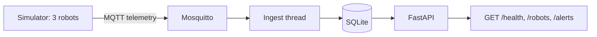

# fleet-monitor

I built this to try out ideas for monitoring a mixed fleet of field devices over MQTT. The questions I kept running into in deployment work were how to spot a device that has gone silent, how to notice a low battery, whether an alert is still trustworthy when packets arrive twice or out of order, and what ingest looks like when a burst of messages arrives. This repo is a personal sandbox: simulated robots publish telemetry, and a FastAPI service keeps the latest state and flags offline, low-battery, and stuck-task conditions. It is not used at work or in production.

## Problem

A watcher of several devices needs one place to see which one is online, what its battery and task look like, and when something needs a person. Devices go quiet. Packets show up twice, or an older packet shows up after a newer one. An alert that fires twice for the same fact, or that a late packet can clear, is not trustworthy.

## Architecture



The ingest loop is a thread in the API process. It is the only writer. Request handlers read the latest row through the same connection. There is no dashboard and no second database: the OpenAPI page at `/docs` is the operator view for this version.

Each robot publishes one JSON snapshot on `fleet/telemetry`:

```json
{
  "robot_id": "robot-1",
  "seq": 12,
  "heartbeat": true,
  "battery": 76.0,
  "pose": {"x": 0.12, "y": -0.98, "theta": 1.6},
  "task": {"id": "robot-1-patrol", "state": "in_progress", "progress": 0.4}
}
```

`seq` is a per-robot counter. Any accepted snapshot is a heartbeat. `task.state` is one of `idle`, `in_progress`, `completed`, `failed`.

## Run

```bash
git clone https://github.com/dannyduyufei/fleet-monitor.git
cd fleet-monitor
docker compose up --build
```

Then open <http://localhost:8000/docs>.

The stack is Mosquitto, the API on port 8000, and a simulator with `robot-1`, `robot-2`, and `robot-3`. The first start pulls a Python image and the Mosquitto image; after that, startup is the container start. SQLite lives at `/tmp/fleet.db` inside the API container and is empty again when that container is recreated.

Useful checks:

```bash
curl -s localhost:8000/health
curl -s localhost:8000/robots
curl -s localhost:8000/robots/robot-1
curl -s localhost:8000/alerts
```

Tests, with no broker required:

```bash
pip install -r requirements-dev.txt
pytest
```

## Trigger an alert

The simulator chooses a scenario from `SIM_SCENARIO`. The default is `healthy`: three robots keep publishing, battery starts at 90% and falls slowly, and task progress keeps moving, so no alert should be open.

Stop the stack before switching scenario so the simulator process picks up the new environment:

```bash
docker compose down
SIM_SCENARIO=offline docker compose up
```

| Scenario | What happens | Alert |
|---|---|---|
| `offline` | `robot-1` publishes three times (one per second), then stops. The other two carry on. | `offline` once the last accepted snapshot is more than `OFFLINE_AFTER_SECONDS` old (default 8). |
| `low_battery` | `robot-2` starts at 30% and drops 5 points each publish. | `low_battery` when battery is below `LOW_BATTERY_PERCENT` (default 20), so the publish at 15%. |
| `stuck` | `robot-3` moves its task for two publishes, then progress stays at 0.50 while state stays `in_progress`. | `stuck_task` once that value has been unchanged for more than `STUCK_AFTER_SECONDS` (default 10). |
| `all` | The three behaviours above, one robot each. | All three kinds at once. |

`SIM_INTERVAL` (default `1`) is the seconds between publishes. Thresholds are environment variables on the API service; compose forwards `OFFLINE_AFTER_SECONDS`, `LOW_BATTERY_PERCENT`, and `STUCK_AFTER_SECONDS`.

```bash
curl -s localhost:8000/alerts
```

An alert is gone on the next read once the condition is gone: the robot publishes again, battery is back at the limit or above, or task progress changes. Nothing in this version stores alert history.

## Design decisions

These are the choices I would walk through.

**One snapshot, one sequence number.** Heartbeat, battery, pose, and task travel together. Ordering is a single integer per robot, so there is no question of a new pose paired with an old battery. A production robot might publish battery faster than pose. That would be another topic and another counter. The rule I would keep is the same: the highest accepted sequence for that stream wins.

**Drop duplicates and anything older. Keep a newer snapshot even if a sequence was skipped.** `seq` less than or equal to the stored sequence does not change the row. An equal sequence is a replay. A smaller one arrived late. A gap means a packet was lost, and the newer snapshot is still the best picture of the robot. I do not buffer to fill gaps. Telemetry is stale the moment a newer snapshot exists.

**Liveness uses the ingest clock, and only on a snapshot that was stored.** `last_seen` is the API machine's time when a message is accepted. The device does not send a timestamp for this. A skewed robot clock would otherwise make a live robot look offline, or a dead one look freshly seen. A rejected duplicate must not move `last_seen` either, or a late replay would hide an offline robot. The sequence check gives that for free: rejected messages do not touch the row.

**Alerts are a function of the rows plus the current time.** `GET /alerts` evaluates the rules on read. There is no alerts table, so the same condition cannot be inserted twice and there is nothing to forget to clear. When the robot recovers, the next read is quiet.

The cost is that there is no history and no acknowledgement. An operator who needs "who cleared the low-battery alert at 14:02" wants another table written when a condition opens and closes. I would add that when someone asks for it, not before.

**An offline robot raises only `offline`.** Battery and task in that row are whatever the last packet said. Reporting low battery and a stuck task on top of silence is three alarms for one fact: we have not heard from it. The other rules run only when the robot is still inside the heartbeat window.

**Thresholds use a strict inequality.** Battery at the limit is not low. Silence of exactly the limit is not offline yet. A reading that sits on the line should not flap. Defaults are 8 seconds, 20% battery, and 10 seconds of unchanged `in_progress` work. `completed`, `failed`, and `idle` are not stuck tasks.

**The process owns reconnect, with capped exponential backoff.** The loop calls `client.loop()` on one socket. A socket error, a dead peer, or a broker that is not up yet ends the session. The thread waits 0.5 seconds, then 1, then 2, up to 5, and connects again. Each session subscribes from scratch. The same loop runs in the simulator, so a broker restart recovers both sides without a special supervisor.

Messages published while the socket is down are dropped. QoS 0 telemetry is republished on the next tick, and the sequence number makes the replay safe. I would not use this loop for commands, where a missed message matters and QoS 1 with a persistent session earns its complexity.

**SQLite, one connection, one lock.** Three robots at one message a second, and a handful of readers, fit in one process. Handlers and the ingest thread share the connection under a lock, and each accepted message is committed on its own, so a crash loses at most the packet in flight.

I would not run two API processes on this file. A second writer is the point where I would move the rows to a server database. Until then Postgres would be another container and no new capability.

**The broker allows anonymous clients, and the API has no application auth.** With compose, the API listens on `0.0.0.0:8000` and Mosquitto is published on port 1883, so this is for local or lab use only — not a shared or public network. Compose has no password to leak and nothing to provision, which is only reasonable in that setting. On a shared network I would turn on broker users and TLS, and put auth on the API.

## Tests

`pytest` covers:

- alert rules, the exact threshold, offline suppression, and both battery and stuck open together
- duplicate, older, and gapped sequence numbers, including that a rejected message does not refresh `last_seen` or restore an old battery reading
- the ingest loop reconnecting after the peer drops the TCP session, and retrying while nothing is listening yet

GitHub Actions runs that suite on pushes to `main` and on pull requests. The reconnect tests speak MQTT to a stub peer in-process, so CI does not need a broker.

## Results

Measured against a stack started with `docker compose up --build -d` (default `healthy` scenario, three robots publishing once a second). The measurement command, from a host venv with `pip install -r requirements.txt`, is:

```bash
python scripts/measure.py
```

The script prints what each number includes. One run:

```
Ingested 300 messages in 0.151s (1990.8 messages/s), from the first publish until GET /robots/measure-load reported seq 300.
Low-battery alert latency over 5 samples, publish until GET /alerts, polled every 20 ms: min 3.1 ms, median 3.5 ms, max 4.1 ms.
low_battery_samples_ms=3.5,3.3,4.1,3.5,3.1
Offline alert observed 8.01s after the heartbeat publish (includes the server offline threshold; default in compose is 8s).
```

The low-battery samples are all shorter than the 20 ms poll, because the script checks once immediately and every sample was already on `GET /alerts`. The offline figure is mostly the configured 8 second silence limit; the alert was visible about 0.01 s after that limit.

Startup, timed until `/health` reported `mqtt_connected`, `GET /robots` listed three robots, and `/docs` contained the Swagger page:

- Images and the build cache removed, then `docker compose up --build -d`: 7.955 s.
- Images already present, `docker compose down` then `docker compose up -d`: 1.408 s.

## Out of scope

A dashboard, WebSocket updates, Postgres, and auth are left out on purpose. The API and `/docs` are enough to see the fleet and the alerts.

## License

MIT

## Disclaimer

Built on my own time, independent of any employer. Not work product of any employer; uses no employer code or customer data; simulated robots only. Not used or deployed at work or in production.
